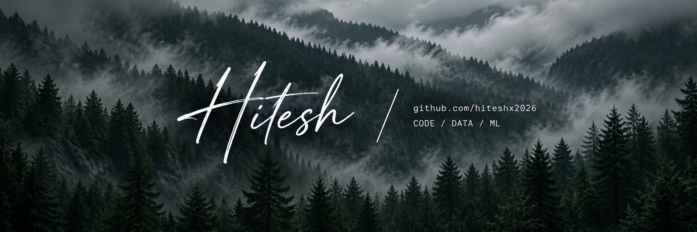
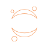

### About me

🧠 Learning **Data Science & Machine Learning**  
💻 Writing code in **Python · Java · C++ · JavaScript**  
🌐 Building with **HTML & CSS**  
🔬 Working with **KNIME & MySQL Workbench**

### Tech Stack

---

<table align="center">
<tr>
<td align="center" width="110"> <b>Python</b></td>
<td align="center" width="110"> <b>Java</b></td>
<td align="center" width="110"> <b>C++</b></td>
<td align="center" width="110"> <b>JavaScript</b></td>
</tr>
<tr>
<td align="center"> <b>HTML</b></td>
<td align="center"> <b>CSS</b></td>
<td align="center"> <b>MySQL Workbench</b></td>
<td align="center"> <b>KNIME</b></td>
</tr>
<tr>
<td align="center" width="110"> <b>SQL</b></td>
<td align="center" width="110"> <b>Node.js</b></td>
<td align="center" width="110"> <b>Linux</b></td>
<td align="center" width="110"> <b>MongoDB</b></td>
</tr>
<tr>
<td align="center" width="110"> <b>PostgreSQL</b></td>
<td align="center" width="110"> <b>Pandas</b></td>
<td align="center" width="110"> <b>NumPy</b></td>
<td align="center" width="110"> <b>Matplotlib</b></td>
</tr>
<tr>
<td align="center" width="110"> <b>PyTorch</b></td>
<td align="center" width="110"> <b>Figma</b></td>
<td align="center" width="110"> <b>Jupyter</b></td>
<td align="center" width="110"> <b>Git</b></td>
</tr>
</table>

  

### 💻 Spent My Time

A visual of my data science learning workflow.

  

#### Contribution skyline

<picture>
<source media="(prefers-color-scheme: dark)" srcset="./profile-3d-contrib/profile-night-rainbow.svg?v=2" />

</picture>

#### Contribution snake

<picture>
<source media="(prefers-color-scheme: dark)" srcset="./assets/github-snake-dark.svg" />

</picture>

 

---

**Made with ❤️ and curiosity**

Code. Explore. Keep learning.

<!-- SETUP.md contains installation instructions. Stats use external services.
     Language charts describe public repositories, not proficiency.
     Skyline and snake appear after a successful profile workflow run. -->

